# 10-Channel YouTube Shorts Setup & Automation Guide

Comprehensive step-by-step walkthrough to set up 10 independent YouTube channels using separate Gmail accounts, delegate central manager access, configure Google Cloud OAuth, and link everything to your automated clipping pipeline.

---

## 📋 Architecture Overview

```mermaid
graph TD
    subgraph Google Cloud Console [Master Gmail - Google Cloud Project]
        OAuth["1 OAuth Client ID (client_secret.json)"]
        TestUsers["Test Users List:<br>All 10 Gmail Addresses Added"]
        OAuth --> TestUsers
    end

    subgraph Channel Accounts [10 Isolated Gmail Accounts]
        G1["Gmail 1: _dailywhiskers"] --> Y1["YT: Daily Whiskers (acc_01)"]
        G2["Gmail 2: _goodboys_club"] --> Y2["YT: Good Boys Club (acc_02)"]
        G3["Gmail 3: _grindandbuild"] --> Y3["YT: Grind & Build (acc_03)"]
        G4["Gmail 4: stoic.societyy"] --> Y4["YT: Stoic Society (acc_04)"]
        G5["Gmail 5: wealthnexus.hq"] --> Y5["YT: Wealth Nexus (acc_05)"]
        G6["Gmail 6: _founder.central"] --> Y6["YT: Founder Central (acc_06)"]
        G7["Gmail 7: food.videos.dailyy"] --> Y7["YT: Food Videos Daily (acc_07)"]
        G8["Gmail 8: ai.tools.dailyy"] --> Y8["YT: AI Tools Daily (acc_08)"]
        G9["Gmail 9: thegroomedman.co"] --> Y9["YT: The Groomed Man (acc_09)"]
        G10["Gmail 10: calmyourmind.ig"] --> Y10["YT: Calm Your Mind (acc_10)"]
    end

    subgraph Central Control [Manager Delegation]
        Y1 -. Manager Invite .-> Master[Master Gmail YouTube Studio]
        Y2 -. Manager Invite .-> Master
        Y3 -. Manager Invite .-> Master
        Y4 -. Manager Invite .-> Master
        Y5 -. Manager Invite .-> Master
        Y6 -. Manager Invite .-> Master
        Y7 -. Manager Invite .-> Master
        Y8 -. Manager Invite .-> Master
        Y9 -. Manager Invite .-> Master
        Y10 -. Manager Invite .-> Master
    end

    subgraph Automation Engine [Python Pipeline]
        CLI["python main.py --channel <id>"] --> Engine["Clip & Caption Engine"]
        Engine --> Tokens["YOUTUBE_REFRESH_TOKEN_ACC_01 ... 10"]
        Tokens --> Y1
        Tokens --> Y2
        Tokens --> Y3
        Tokens --> Y4
        Tokens --> Y5
        Tokens --> Y6
        Tokens --> Y7
        Tokens --> Y8
        Tokens --> Y9
        Tokens --> Y10
    end
```



---

## Stage 1: Channel Setup on Each of the 10 Gmails

Repeat these quick steps for each of your 10 Gmail accounts:

### 1.1 Create the YouTube Channel
1. In your browser (or in an incognito/profile window), log into **Gmail #1**.
2. Go to **[youtube.com](https://www.youtube.com)**.
3. Click your profile avatar in the top right corner → click **Create a channel**.
4. Set the Channel Name and Handle according to the table below:

| Account ID | Channel Name | Handle | Matching IG |
|---|---|---|---|
| **`acc_01`** | **Daily Whiskers** | `@daily_whiskers` | `_dailywhiskers` |
| **`acc_02`** | **Good Boys Club** | `@goodboys_club` | `_goodboys_club` |
| **`acc_03`** | **Grind & Build** | `@grindandbuild` | `_grindandbuild` |
| **`acc_04`** | **Stoic Society** | `@stoic.societyy` | `stoic.societyy` |
| **`acc_05`** | **Wealth Nexus** | `@wealthnexus_hq` | `wealthnexus.hq` |
| **`acc_06`** | **Founder Central** | `@founderr.central` | `_founder.central` |
| **`acc_07`** | **Food Videos Daily** | `@food_videos_daily` | `food.videos.dailyy` |
| **`acc_08`** | **AI Tools Daily** | `@ai.tools.dailyyy` | `ai.tools.dailyy` |
| **`acc_09`** | **The Groomed Man** | `@the.GroomedMan` | `thegroomedman.co` |
| **`acc_10`** | **Calm Your Mind** | `@calmyourmind.youtube` | `calmyourmind.ig` |

### 1.2 Channel Customization (Bio, Links & Avatar)
1. In the left sidebar, click **Customization** → **Basic info**:
   - **Handle**: Confirm the handle.
   - **Description**: Add a 2-line bio explaining what the channel posts.
   - **Links**: Click **Add link** → Title: `Instagram`, URL: `https://instagram.com/<your_ig_handle>`. (This automatically links your YouTube audience back to your Instagram page).
2. Click **Branding**:
   - Upload your square avatar (800x800 px) matching your Instagram profile picture.
3. Click **Publish** (top right).

### 1.3 Delegate Manager Access to Your Main Gmail (Eliminates Account Switching)
1. In YouTube Studio, click **Settings** (gear icon in the lower left) → **Permissions**.
2. Click **Invite** in the top right.
3. Enter your **main personal Gmail address**.
4. Access: Select **Manager** (allows you to view analytics, edit videos, and manage uploads from your main account without sharing ownership).
5. Click **Done** → **Save**.
6. Switch to your main Gmail inbox and click **Accept Invitation**.

> [!TIP]
> Once all 10 invites are accepted, you will **never** need to log into the other 9 Gmails on your computer or phone again! You can simply click your profile icon in YouTube Studio and switch between all 10 channels in 1 click.

---

## Stage 2: One-Time Google Cloud OAuth Setup (Master Gmail)

You only do this **ONCE** on your master Google account. A single Google Cloud project handles all 10 channels.

### 2.1 Create Project & Enable API
1. Go to **[Google Cloud Console](https://console.cloud.google.com/)** signed into your master Google account.
2. In the top bar, click the project dropdown → **New Project**.
3. Name it: `Shorts-Pipeline-Hub` → click **Create**.
4. In the left menu, go to **APIs & Services** → **Library**.
5. Search for `YouTube Data API v3` → click it → click **Enable**.

### 2.2 Configure OAuth Consent Screen
1. In the left sidebar, click **OAuth consent screen**.
2. User Type: Select **External** → click **Create**.
3. **App Information**:
   - App name: `Shorts Auto Uploader`
   - User support email: Select your email.
   - Developer contact email: Enter your email.
   - Click **Save and Continue**.
4. **Scopes**:
   - Click **Add or Remove Scopes**.
   - Search for `youtube.upload` (`https://www.googleapis.com/auth/youtube.upload`).
   - Check the box → click **Update** → click **Save and Continue**.
5. **Test Users (Crucial Step)**:
   - Click **Add Users**.
   - Add **all 10 Gmail addresses** that own your YouTube channels.
   - Click **Save and Continue**.

### 2.3 Create OAuth Client ID & Download Credentials
1. In the left sidebar, click **Credentials**.
2. At the top, click **+ Create Credentials** → **OAuth client ID**.
3. Application type: Select **Desktop app**.
4. Name: `Shorts-Desktop-Client`.
5. Click **Create**.
6. A popup appears. Click **Download JSON**.
7. Rename the downloaded file to:
   ```text
   client_secret.json
   ```
8. Move `client_secret.json` into the root of this project:
   `c:\Users\kusha\OneDrive\Desktop\yt-clip-pipeline\client_secret.json`.

---

## Stage 3: Generate the 10 Refresh Tokens

The pipeline provides a multi-channel token generator tool: [`pipeline/get_youtube_token.py`](pipeline/get_youtube_token.py).

Run the command for each channel one by one:

### 3.1 Channel 1: Cat Videos (`acc_01_cats`)
```powershell
python pipeline/get_youtube_token.py --channel acc_01_cats
```
1. Your default browser will open asking you to sign in.
2. Sign in with **Gmail #1** (`_dailywhiskers`).
3. Click **Continue** (if Google shows an "unverified app" screen, click *Advanced → Go to Shorts Auto Uploader (unsafe)*).
4. Click **Allow** to grant YouTube upload permission.
5. In your terminal, you will see:
   ```text
   =======================================================
    ✅ YouTube OAuth Authentication Successful!
   =======================================================
   YOUTUBE_CLIENT_ID=...
   YOUTUBE_CLIENT_SECRET=...
   YOUTUBE_REFRESH_TOKEN_ACC_01_CATS=1//04...
   =======================================================
   ```
6. Copy the `YOUTUBE_REFRESH_TOKEN_ACC_01_CATS` line into your `.env` file!

### 3.2 Channels 2 through 10
Repeat the same command with the respective channel name:
```powershell
python pipeline/get_youtube_token.py --channel acc_02_dogs
python pipeline/get_youtube_token.py --channel acc_03_fitness
python pipeline/get_youtube_token.py --channel acc_04_motivation
python pipeline/get_youtube_token.py --channel acc_05_finance
python pipeline/get_youtube_token.py --channel acc_06_business
python pipeline/get_youtube_token.py --channel acc_07_food
python pipeline/get_youtube_token.py --channel acc_08_ai_tools
python pipeline/get_youtube_token.py --channel acc_09_grooming
python pipeline/get_youtube_token.py --channel acc_10_mental_health
```
Sign in with the corresponding Gmail each time and paste each generated token into `.env`.

---

## Stage 4: Environment Variables Reference

Your `.env` file in `yt-clip-pipeline/` will look like this:

```env
# Google Cloud App Credentials (shared by all channels)
YOUTUBE_CLIENT_ID=xxxx.apps.googleusercontent.com
YOUTUBE_CLIENT_SECRET=GOCSPX-xxxx

# Per-Channel OAuth Tokens
YOUTUBE_REFRESH_TOKEN_ACC_01=1//04xxxx...
YOUTUBE_REFRESH_TOKEN_ACC_02=1//04xxxx...
YOUTUBE_REFRESH_TOKEN_ACC_03=1//04xxxx...
YOUTUBE_REFRESH_TOKEN_ACC_04=1//04xxxx...
YOUTUBE_REFRESH_TOKEN_ACC_05=1//04xxxx...
YOUTUBE_REFRESH_TOKEN_ACC_06=1//04xxxx...
YOUTUBE_REFRESH_TOKEN_ACC_07=1//04xxxx...
YOUTUBE_REFRESH_TOKEN_ACC_08=1//04xxxx...
YOUTUBE_REFRESH_TOKEN_ACC_09=1//04xxxx...
YOUTUBE_REFRESH_TOKEN_ACC_10=1//04xxxx...
```

If you use **GitHub Actions** for 24/7 cloud scheduling:
Add the exact same variables under your repository: **Settings → Secrets and variables → Actions**.

---

## Stage 5: Testing & Running Auto-Uploads

### 5.1 Test Upload in Private Mode
All channels come configured with `privacy_status: "private"` by default so you can safely verify the result before going public.

To test uploading for an individual channel:
1. Open the channel's config (e.g. [`config/channels/acc_04_motivation.yaml`](config/channels/acc_04_motivation.yaml)).
2. Set:
   ```yaml
   auto_upload: true
   ```
3. Run the channel:
   ```powershell
   python main.py --channel acc_04_motivation
   ```
4. Check your YouTube Studio app: the Short will appear with full captions, formatted description, tags, and Fair Use attribution.

### 5.2 Switching to Public (Hands-Free Mode)
Once you are satisfied with video framing and captions:
In [`config/channels/*.yaml`](config/channels/), update:
```yaml
youtube:
  privacy_status: "public"
```

### 5.3 Daily Cadence & Commands
- **Run a single channel:**
  ```powershell
  python main.py --channel dogs
  python main.py --channel ai_tools
  ```
- **Run all 10 channels:**
  ```powershell
  python main.py --channel all
  ```
- **Automated Cloud Cron:** The GitHub Actions workflow ([`.github/workflows/clip-pipeline.yml`](.github/workflows/clip-pipeline.yml)) will automatically trigger every 6 hours and process clips across your channels within your anti-spam budget.
